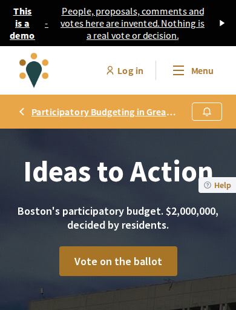
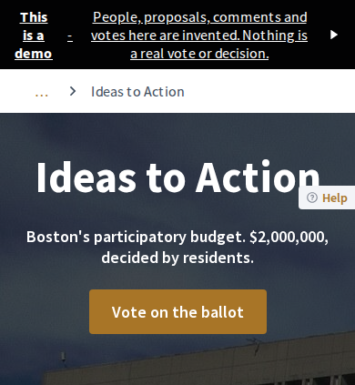
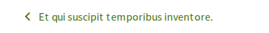
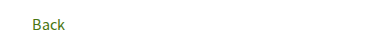
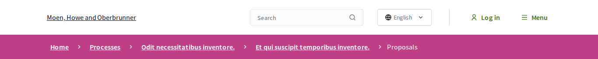
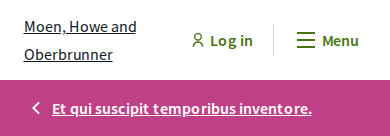

# Frontdoors

Frontdoors lets you put a front door on any page of a space: someone arriving from a flyer walks straight in,
without crossing the lobby.

A module for [Decidim](https://decidim.org), the open-source participation platform. Add `?frontdoor=1` to the
address of any page inside a participatory space and the visitor gets that page without Decidim's navigation: no
logo bar, no search, no menu, no footer of links. A thin white band with a short trail of links is all that is
left above the page. Nothing changes for anyone who never uses such a link.

| Before: the page as Decidim draws it, 390 px wide | After: the same page with the switch in its address |
| --- | --- |
|  |  |

demo.gathers.today, November 12, 2026, where this was built and first ran (there the switch was still called
`?focus=1`; the page is the same). Photo: "2017 Boston City Hall 1" by Beyond My Ken, CC BY-SA 4.0, Wikimedia
Commons. The black strip is that site's own "This is a demo" notice.

The band alone, on a clean Decidim with its seed data (the names are the seed data's own filler text):

| Where | 1366 px wide | 390 px wide |
| --- | --- | --- |
| A list, reached from the space's front page |  |  |
| An idea, landed on directly |  |  |
| The pointer on a link |  |  |
| The log-in page during a visit |  |  |
| For comparison: Decidim's own header and breadcrumb on the same list |  |  |

## How to make a link

Take the address of any page inside a space and add `?frontdoor=1`:

    https://your.site/processes/riverside-budget?frontdoor=1
    https://your.site/assemblies/youth-council/f/12/meetings/48?frontdoor=1

(If the address already has a `?`, add `&frontdoor=1` instead.) Put that link on the flyer, in the text message
or behind the QR code. It works on every page of a participatory process, an assembly, an initiative or a
conference, and on the page of a process group. There is nothing to switch on for a space and nothing to set up:
the link is the whole feature.

To leave, a visitor presses "…" until they reach a page with full navigation, or opens any address with
`?frontdoor=0`.

## What a visitor meets

A **visit** starts at the link and lasts until the visitor reaches a page that is not kept (below) or closes the
browser.

| The visitor | What happens |
| --- | --- |
| opens any page inside a space or a process group with `?frontdoor=1` | No navigation. Laptop: "… › the space › … › that page". Phone: "… › that page" |
| goes deeper from there | Still no navigation. Laptop: the trail grows. Phone: one link, to the page one step up |
| presses "…" on a laptop | The page one step above the space opens: its process group or parent assembly, without navigation; or, for a space with neither, the page that lists all spaces of its kind, which is the full site |
| presses "…" on a phone | The page one step up opens, without navigation: above an idea its list, above a list the space |
| follows a link to another space (a related process) | Still no navigation, in that space |
| opens the log-in, sign-up, password, email confirmation or account unlock page, or the Terms of Service | Still no navigation; the band is one link, "Back", to where the visit's trail started |
| logs in | Still no navigation |
| creates an account | The sign-up page is without navigation. When the form is sent, Decidim takes the new account to the home page: full navigation, and the visit is over (see "Known limits") |
| is sent to verify their account, opens a verification method's pages, or the list of their verifications | Still no navigation; the band is "Back" |
| opens the ballot of a budget while voting is open | Decidim's own voting view, as before, with its own "Back" link; no navigation again on the way out |
| opens any other page that is not in a space: the home page, a list of all spaces, search, a profile, a help page, the account | Decidim's full navigation, and the visit is over: a space opened afterwards is the full site, until the next `?frontdoor=1` link |
| opens any page with `?frontdoor=0` | Full navigation again; the visit is over |
| adds `?frontdoor=1` to a page that is not in a space, with no visit on | Nothing |
| never uses such a link | Nothing changes |

"Laptop" is a window 1024 px wide or more; "phone" is anything narrower.

**What stays without navigation during a visit**

- Every page of every space, and every process group's page.
- Decidim's log-in pages: log-in, sign-up, password, email confirmation, account unlock, accepting an invitation,
  finishing a sign-up from a social account.
- Decidim's verification pages (a **verification** is Decidim's check that a participant is who they say, before
  they may vote or sign): the "verify your account" page, each verification method's own pages, and the list of a
  participant's verifications.
- The Terms of Service page, which the sign-up form links to.

On the last three kinds the band is one link, "Back", to where the visit's newest trail started.

**What ends a visit**

- Any other page: the home page, a page that lists all spaces, search, a profile, another help page, the account,
  notifications, conversations. It is drawn exactly as Decidim draws it, and from then on so is every page.
- An address with `?frontdoor=0`.
- Closing the browser.

## Install

Add one line to your application's `Gemfile`:

```ruby
gem "decidim-frontdoors", git: "https://github.com/Wildest-Future/decidim-module-frontdoors", tag: "v0.1.0"
```

Then:

```bash
bundle install
```

and deploy as you usually do. There is no migration to run and no setting to choose. Your deploy has to compile
the assets, as every Decidim deploy does (`bin/rails assets:precompile`): the band's looks are a stylesheet that
is compiled into Decidim's own. On a development machine, compile once with `bin/shakapacker` if the navigation
is hidden but the band looks wrong.

To remove it, delete the line, `bundle install` and deploy. Nothing is left behind.

## Which Decidim

| Frontdoors | Decidim |
| --- | --- |
| 0.1.x | 0.32, from 0.32.2 on (`>= 0.32.2, < 0.33`) |

It was built and checked on Decidim 0.32.2 with Ruby 3.4.7. A guard in the specs fails when a Decidim upgrade
changes one of the templates or names the module relies on, so a new Decidim version needs a look before the
range is widened.

## How it hooks into Decidim

Plainly: it edits one Decidim template, with [Deface](https://github.com/spree/deface), a library that changes a
template when it is loaded. The edit adds one line to Decidim's `layouts/decidim/_head`, the template every
public page's head is drawn from:

```erb
<% Decidim::Frontdoors.apply(self) %>
```

The line prints nothing. Decidim draws the head before the body tag and before the breadcrumb bar, so the code
that line calls can do its two things in time: add a class (a label) to the page's body tag, and shorten the
list of crumbs Decidim is about to print. Decidim's own templates then draw the breadcrumb bar from the shorter
list, and the module's stylesheet, on pages with that class, hides the main bar, the follow button and the
footer's columns and restyles the breadcrumb bar into the band.

That one line is the only edit to anything of Decidim's. No Decidim method is replaced and no Decidim template
is copied. If your application has its own `app/views/layouts/decidim/_head_extra.html.erb` (the file Decidim
provides for an application's own head content), it is not touched and keeps working: it is a different file.

On a page opened without the switch and without the module's cookie, the code stops at its first line, and the
page comes out byte for byte as it does without the module (measured: [the hook](docs/2026-11-13-hook.md)). The
one thing that differs on every page is the name of Decidim's stylesheet file, which carries a fingerprint of its
contents, and the module's rules are in that file.

The module has no page, route, database table, setting, admin screen or script of its own, and the band has no
words of its own: "Back" and "Home" are Decidim's, in every language Decidim has. The band's colors are your
organization's own (its secondary color) and Decidim's white and grey.

Other modules that edit the same template with Deface (decidim-awesome does) are not in its way: each adds its
own line.

## The cookie

During a visit the module keeps one cookie, `decidim_frontdoors`. It remembers that the visitor arrived through
a link that hides the site's navigation, so that the next pages stay that way, and where their trail started in
each space (up to six). It holds no account and no name. It has no expiry date, so the browser drops it when it
is closed. The server signs it; scripts on the page cannot read it; it is not sent with requests that start on
other sites; on an https site it is sent over https only. Outside a visit there is no cookie at all.

The module lists it in Decidim's cookie notice, in the "Essential" group, with a description in English, Spanish
and Catalan. In any other language Decidim shows the English one.

## How it differs from Decidim's "focus mode"

Decidim has a focus mode of its own, which only budget voting uses: while a participant fills in a ballot, the
page asks the layout for it, the main bar becomes one "Back" link, and the breadcrumb bar and the footer's
columns are left out.

| | Decidim's focus mode | Frontdoors |
| --- | --- | --- |
| Who starts it | The page itself (budget voting) | Whoever makes the link, on any page of any space |
| How long it lasts | That page | The visit: every page of every space, until a page with full navigation |
| What is left at the top | One "Back" link, 64 to 96 px tall | A trail of links to the space and its parts, 48 px tall |
| What it is for | Finishing one task without leaving | Arriving from outside without crossing the platform |

Frontdoors does not use Decidim's focus mode and does not change it. A budget's voting pages keep Decidim's own
header; the visit goes on behind them and the band is back on the way out.

## Known limits

- **Someone who creates an account from a Frontdoors link is taken to the site's home page and has to find the
  space again.** The sign-up page itself, and the terms it links to, are without navigation. But when the form
  is sent, Decidim takes the new account to the home page, and the link in the confirmation email then opens
  the home page too (or the "verify your account" page, when what they pressed needs a verification), with full
  navigation. Decidim does this with or without this module; the module only makes it more noticeable, because
  the home page ends the visit. Logging in with an existing account keeps a visitor where they were, through the
  log-in prompt and any verification, back to the page they came from.
- **Nothing to log in or out with on the band.** The log-in link, the account menu and log-out are in the main
  bar, which is hidden. A visitor reaches the log-in prompt by pressing something that needs an account (vote,
  sign, comment), which keeps the visit. A logged-in visitor cannot log out from a page without navigation.
- **No logo and no language switch on the band.** A visit begun on an address in one language stays in it.
- **The service worker's copy of a page.** Decidim installs a script in the visitor's browser (a service worker)
  that keeps a copy of every page for an hour and shows it when the server takes more than 3 seconds to answer
  or the browser is offline. The copy is the page as it was drawn then. So on a slow server or without a network
  a visitor can be shown a page without navigation outside a visit, or a full one inside it. It happened once
  while this was being checked, on a development machine that took just over 3 seconds to draw a page; the
  walk now says so when a step shows such a copy.
- **Idea and meeting pages are as Decidim draws them.** The module changes what is around a page, not the page.
- **A verification method from another module** keeps its pages in the visit when it registers them with Decidim
  as the method's engine, which is how Decidim asks for it. Pages it draws elsewhere end the visit.
- **Budget voting, and visitors with a temporary session**, keep Decidim's own bare header (above).
- **Pages with no crumb of their own** (a conference's speakers, a budget's project) show the trail one step
  short, as Decidim's breadcrumb does with or without this module.
- **Hidden, not removed.** The navigation is still sent to the browser and hidden there (also from screen
  readers and keyboards), so a page weighs what it weighed.
- **Search engines** are given the shortened trail as the page's breadcrumb on a page opened with the switch.

**What nobody has checked:** a real phone (the phone checks are a desktop browser at 390 px with touch); a
screen reader (what it says for "…" was read from the page, not listened to); a language written right to left;
private spaces; a browser offline during a visit; a site in production mode other than demo.gathers.today,
which ran the same rule from its own code, not from this package.

## Tests

Everything runs in containers, as your own user; nothing is installed on your machine but Docker.

```bash
printf 'APP_UID=%s\nAPP_GID=%s\n' "$(id -u)" "$(id -g)" > .env
docker compose build app
docker compose run --rm app bundle install
docker compose run --rm app npm install
```

**The specs** (99 examples): the rule and what it does to a page; a guard that fails when a Decidim upgrade
changes a template, a helper or a name the module relies on, or when the Deface edit stops applying; and real
pages drawn in a browser against a generated test application.

```bash
docker compose run --rm app bundle exec rake test_app
docker compose run --rm -w /app/spec/decidim_dummy_app -e RAILS_ENV=test app bundle exec rails shakapacker:compile
docker compose run --rm app bundle exec rspec
docker compose run --rm app bundle exec rubocop
docker compose run --rm app npm run stylelint
```

**The walk**: a scripted browser that goes through fifteen checks at 390 and 1366 px, each in a fresh browser
and in one that Decidim's service worker controls, and writes every step into a table with its own verdict. It
runs against the development application, a clean Decidim with seed data at http://localhost:3033:

```bash
docker compose run --rm app bundle exec rake development_app
docker compose run --rm -w /app/development_app app bin/rails runner /app/script/walk/prepare.rb
docker compose --profile development_app up -d web sidekiq
script/walk/run walk.cjs http://localhost:3033 tmp/walk
```

`prepare.rb` sets two things Decidim's random seed data leaves out: voting open in one budget, and one action
(liking a proposal) that requires verification. The development application's accounts are the ones
Decidim's seeds create: `admin@example.org` and `user@example.org`, password `decidim123456789`. After changing
the stylesheet: `docker compose --profile development_app exec web bin/shakapacker`.

The last walk's table is in [docs/walk](docs/walk/). CI runs RuboCop, stylelint and the specs on every push.

## License

[GNU Affero General Public License v3.0 or later](LICENSE-AGPLv3.txt), like Decidim.

## Credits

Developed by Wildest Future for gathers.today.

## Security

Please report a vulnerability through GitHub's private reporting: the "Report a vulnerability" button under this
repository's Security tab. Please do not open a public issue for it.
